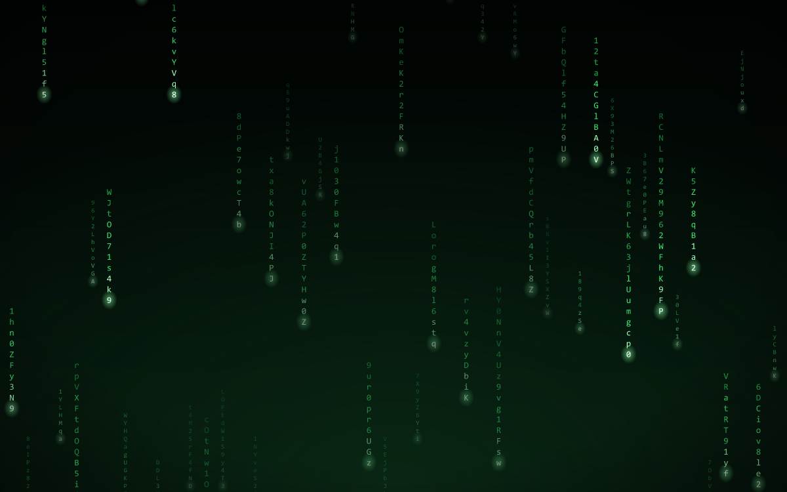

# Claude Desktop Themes

Claude デスクトップアプリ（Code タブ）の見た目を変える mod テーマ集です。会話の後ろに動く背景を描き、配色と吹き出しも変えます。

| テーマ | 内容 |
| --- | --- |
| `galaxy-night` | 立体ブロックで描いた宇宙。太陽、地球と月、輪のある惑星、ブラックホール、渦巻き銀河、星雲、彗星がゆっくり動きます |
| `digital-rain` | 黒い画面を緑の英数字の列が上から降り続けます |
| `event-horizon` | 丸いドットで描いた巨大なブラックホール。降着円盤の明るいかたまりがゆっくり回ります |

### galaxy-night


### digital-rain



### event-horizon


画像は会話の後ろに描かれる背景だけを書き出したプレビューです。実際のアプリでは、この上に会話がすりガラス越しに重なり、星や天体、文字の列、円盤のかたまりが動きます。

## インストール

ターミナルで Claude Code を起動し、プロンプトに次を入力します（`y` でマーケットプレイスを追加し、スコープは user を選びます）。

```
/plugin install galaxy-night --marketplace konnnyakuimo2000/claude-desktop-themes
```

```
/plugin install digital-rain --marketplace konnnyakuimo2000/claude-desktop-themes
```

```
/plugin install event-horizon --marketplace konnnyakuimo2000/claude-desktop-themes
```

シェルからは次のとおりです。

```
claude plugin install galaxy-night --marketplace konnnyakuimo2000/claude-desktop-themes
```

デスクトップアプリでは `/plugin` が使えないので、プロンプト欄の横の + から Plugins を開き、Add marketplace に `konnnyakuimo2000/claude-desktop-themes` を入れてから Add plugin でテーマを選びます。

ターミナルからユーザースコープで入れたテーマは、デスクトップアプリの Code タブのセッションにも読み込まれます。

## テーマの切り替え

使いたいテーマを入れておき、Claude Code のプロンプトでテーマ名を入力すると切り替わります。

```
/galaxy-night
```

```
/digital-rain
```

```
/event-horizon
```

今のセッションにすぐ反映され、選んだテーマは `~/.claude/claude-desktop-themes.json` に保存されるので、次のセッションからもそのテーマになります。1つだけ入れた場合は、そのテーマがそのまま使われます。

## 必要なもの

- Claude Code v2.1.323 以降と、mod の背景を描く Claude デスクトップアプリ
- OS の「アニメーション効果」（動きを減らす設定）がオフになっていないこと。動きを減らす設定のときは止まった絵で表示されます

各テーマの詳しい内容は `mods/<テーマ名>/README.md` にあります。
